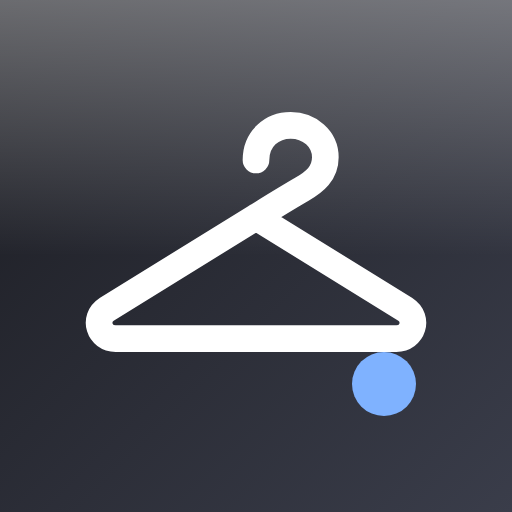
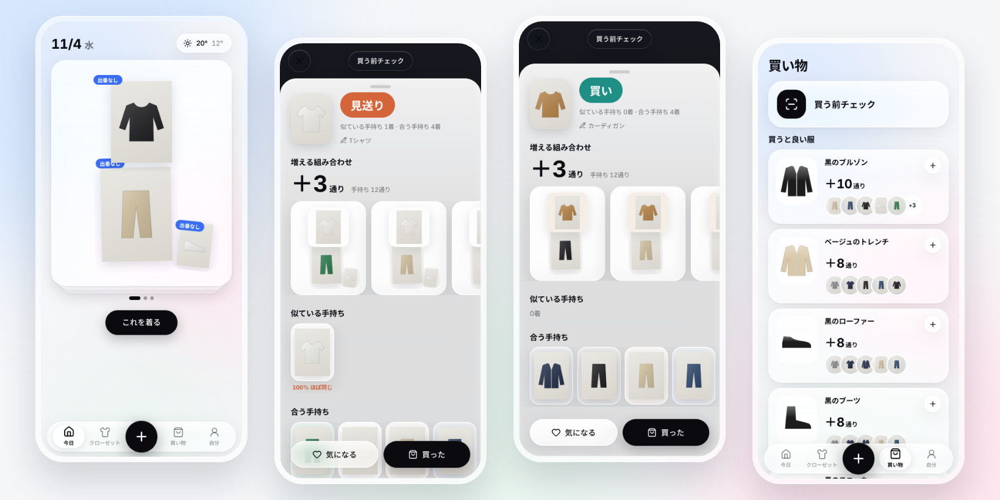

<p align="center">
  
</p>

# Mottenai

> 買う前に、クローゼットを確かめる。

[English](README.md) · **日本語**

[](https://github.com/ttk1010/mottenai/actions/workflows/deploy.yml)
[](LICENSE)
[](https://workers.cloudflare.com/)
[](https://www.typescriptlang.org/)

<p align="center">
  
</p>

## Mottenai とは

服を買いに行っても何を買えばいいか分からず、**似た服や、手持ちと組み合わせづらい服を買ってしまう**。Mottenai はこの悩みのためのスマホ向けクローゼット管理アプリです。

店で服を撮ると、クローゼットの中身すべてと比べて数秒で答えます。

- **買い／保留／見送り**：雰囲気ではなく、ルールで判定
- **＋N通り**：手持ちの服と組んで、コーデが何通り増えるか
- **似ている手持ち**：似ている度合い（%）つき。85%以上は「ほぼ同じ」
- **合う手持ち**：出番のない服と合うものには印

ほかに、**買うと良い服**を「足すと何通り増えるか」の順に並べます。**今日のコーデ**は天気に合わせて出し、1案は必ず出番のない服を使います。

名前は「もったいない」と「持ってない」を掛けています。持っている物ではなく、持っていない物を買う。

> 📖 README は日本語・英語の2言語です。設計ドキュメント（`docs/`・ADR）とアプリの画面は**日本語**です。

## 判定の例

白いTシャツをすでに持っているときに、白いTシャツをチェックした場合です。

| 項目 | 結果 |
|---|---|
| 判定 | **見送り** |
| 理由 | 似ている手持ち 1着 · 合う手持ち 4着 |
| 増える組み合わせ | ＋3通り（手持ちで組めるのは12通り） |
| 似ている手持ち | 白のTシャツ ― **100% ほぼ同じ** |

同じクローゼットでキャメルのカーディガンをチェックすると、**買い** になります（似ている物なし・＋3通り・合う手持ち4着）。**買った** を押すと、いま撮った写真のままクローゼットに追加されます。撮り直しは不要です。

ほかの画面は [docs/screenshots/](docs/screenshots/) にあります。

## 必要なもの

- **Cloudflare のアカウント（無料）**：Workers・D1・R2・Images・Workers AI を無料プランで使います。R2 の有効化でカード登録を求められますが、課金されるのは月10GBを超えた分だけです
- **Google Cloud のプロジェクト（無料）**：ログインは Google のみです
- **GitHub のリポジトリ**：GitHub Actions で自動公開します
- **Node.js 22 以上**：手元で開発するとき

### 費用

個人や少人数で使う分には無料です。無料枠を超えても、多くは**課金ではなく機能が止まる**動きで、アプリ自体は動き続けます。

| サービス | 無料枠 | 超えたら |
|---|---|---|
| Workers | 1日10万リクエスト | エラーになる |
| D1 | 5GB、1日500万行の読み込み | エラーになる |
| R2 | 月10GB | **課金される**（写真は1着1MB以下。1万着程度まで入る） |
| Workers AI | 1日1万 Neurons | 自動タグ付けが止まり、手で選ぶ形になる |
| Images | 月5,000回の変換 | 背景を切り抜かずに登録される |

料金は変わることがあります。[Cloudflare の料金ページ](https://www.cloudflare.com/plans/developer-platform/) を確認してください。

## クイックスタート（ローカル）

```bash
# 1. インストール
npm install

# 2. ローカル用の設定：開発用ログイン＋仮のAI（Cloudflare の認証情報は不要）
cp .dev.vars.example .dev.vars
npm run db:migrate:local

# 3. 起動
npm run dev        # → http://localhost:5173 で「開発用ログイン」
```

Workers AI はリモートでしか動かないので、ローカルでは `MOCK_AI=1` で仮のタグを付けます。背景の切り抜きもローカルでは動きません。

```bash
npm test           # 判定エンジンのテスト
npm run typecheck
npm run lint
```

## 公開する

**[docs/SETUP_GUIDE.md](docs/SETUP_GUIDE.md) の手順書に沿って進めてください。** 初めての人向けに、クリックする場所まで書いてあります。

1. **Cloudflare**：APIトークン、D1、R2、`workers.dev` のサブドメイン
2. **GitHub**：Actions の Secrets を4つ、`wrangler.jsonc` に `database_id`
3. **Google**：OAuth の同意画面、テストユーザー、クライアント

設定が終わると、`main` に push するたびに次の処理が自動で走ります。

1. Lint・型チェック・テスト・ビルド
2. DB のテーブル更新
3. 公開
4. Google のシークレットの反映

公開先は `https://mottenai.<サブドメイン>.workers.dev` です。

うまくいかないときは [docs/TROUBLESHOOTING.md](docs/TROUBLESHOOTING.md) を見てください。

## できること

- **1着3秒の登録**：＋を押すとすぐカメラが開き、続けて撮れます。送信は裏で進みます。写真（最大50枚）、商品ページのURL、共有メニューからも取り込めます
- **入力はAIまかせ**：背景の切り抜き（Cloudflare Images）と、タグ付け（Workers AI）を自動で行います。タグはカテゴリ・色・柄・きちんと度・暖かさ・季節・シルエットです。確認前のアイテムも提案に使われます
- **スワイプで確認**：AIのタグを右スワイプで確定し、タグを押せばその場で直せます
- **買う前チェック**：＋の長押し、またはホーム画面のショートカットから。その場で「買い／保留／見送り」を出します
- **買うと良い服**：足すとコーデが何通り増えるかの順に並べます。持っている物に似た候補は外します。買い物リストに保存できます
- **今日のコーデ**：天気に合わせて3案出し、1案は出番のない服を使います。服を押すと入れ替わり、**これを着る** で着た記録が付きます
- **10着で最初の提案**：初回は10着登録した時点で、組めるコーデの数を見せます
- **Liquid Glass（白基調）**：画面全体にアニメーションと、全画面のスケルトン表示があります。`prefers-reduced-motion` に対応しています
- **データは自分のもの**：JSONで書き出せます。アカウントを削除すると写真ごと消えます

## しくみ

```
スマホ（PWA）── React SPA ── 判定エンジンはブラウザで実行
     │
     ▼
Cloudflare Worker（Hono）
  ├─ Google OAuth（Arctic）＋ Cookie のセッション
  ├─ D1 ──────── ユーザー・服・着た記録・気になる
  ├─ R2 ──────── 写真と切り抜き（非公開。本人にだけ返す）
  ├─ Images ──── 背景の切り抜き
  └─ Workers AI ─ 写真 → タグ（タグだけ。判定はしない）
```

**判定はルール、AIはタグ付けだけ。** 似ている度合い・相性・＋N通り・判定は、テストのある決定的なルール（[`src/shared/engine.ts`](src/shared/engine.ts)）で計算します。そのため、画面の数字の根拠がいつも同じで、説明できます。詳しくは [docs/ARCHITECTURE.md](docs/ARCHITECTURE.md) と [ADR 0001](docs/adr/0001-rule-based-judgment.md) にあります。

## 考え方

Mottenai は、ファッションのSNSでも、買い物への誘導でもありません。自分で思い出せないとき、代わりにクローゼットを覚えておく相談相手です。

- **決める瞬間に答える**：家の朝ではなく、店頭で
- **形容詞より数字**：`似ている 87%`、`＋12通り`。キャッチコピーは入れない
- **登録は手軽に**：必須の入力は写真だけ
- **売り込まない**：送客をしないので、「見送り」と言える
- **無料で動かす**：Cloudflare の無料枠で動き、枠を超えても止まらない

この考え方の元になった調査と分析は、[docs/01-research.md](docs/01-research.md) と [docs/02-pain-analysis.md](docs/02-pain-analysis.md) にあります。

## ドキュメント

| ドキュメント | 内容 |
|---|---|
| [docs/SETUP_GUIDE.md](docs/SETUP_GUIDE.md) | セットアップ手順書（Cloudflare・Google・GitHub） |
| [docs/TROUBLESHOOTING.md](docs/TROUBLESHOOTING.md) | セットアップと運用のトラブル対処 |
| [docs/01-research.md](docs/01-research.md) | 既存アプリの調査 |
| [docs/02-pain-analysis.md](docs/02-pain-analysis.md) | ペイン分析・やりたいこと（JTBD） |
| [docs/03-ux-design.md](docs/03-ux-design.md) | UX設計（流れ・画面・アニメーション・スケルトン） |
| [docs/04-tech-stack.md](docs/04-tech-stack.md) | 技術選定と理由 |
| [docs/ARCHITECTURE.md](docs/ARCHITECTURE.md) | 構成とデータの流れ |
| [docs/adr/](docs/adr/) | 設計判断の記録（ADR） |
| [docs/ROADMAP.md](docs/ROADMAP.md) | ロードマップ |

## ロードマップ・状況

🚧 **MVP 完成・公開済み**（Phase 1）。次の Phase 2 では、次の3つに取り組みます。
- 本番でのAIタグの精度の測定
- モデル着用写真から服だけを切り出す
- サポート終了になったログインのライブラリの置き換え

詳しくは [docs/ROADMAP.md](docs/ROADMAP.md) を見てください。

## コントリビュート

小さく、Issue から始める変更を歓迎します。[CONTRIBUTING.md](CONTRIBUTING.md) を見てください。

## ライセンス

[MIT](LICENSE) © 2026 ttk1010
