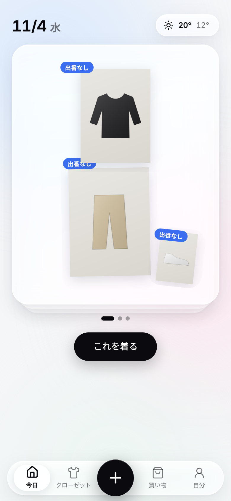
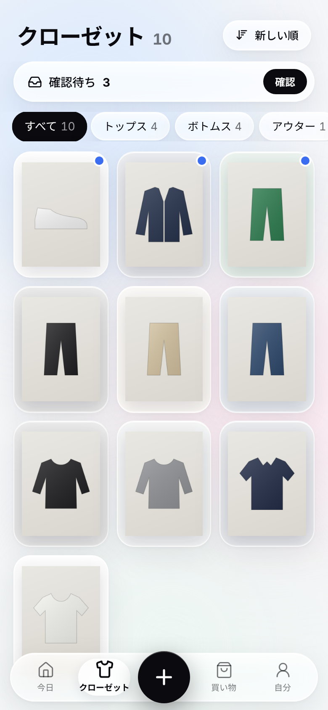
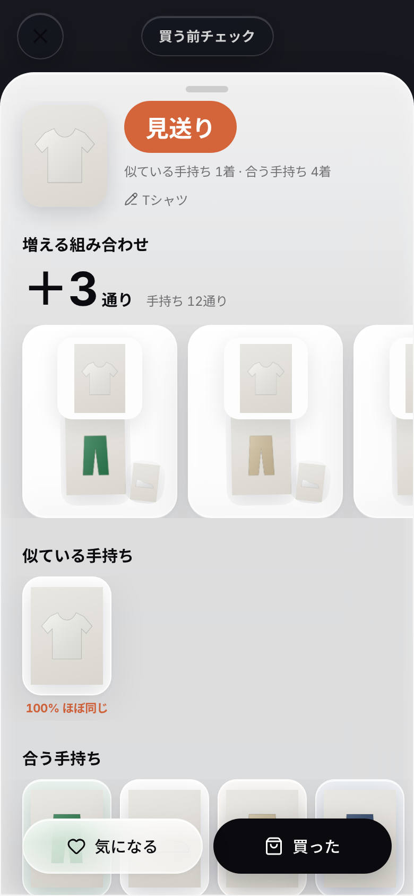
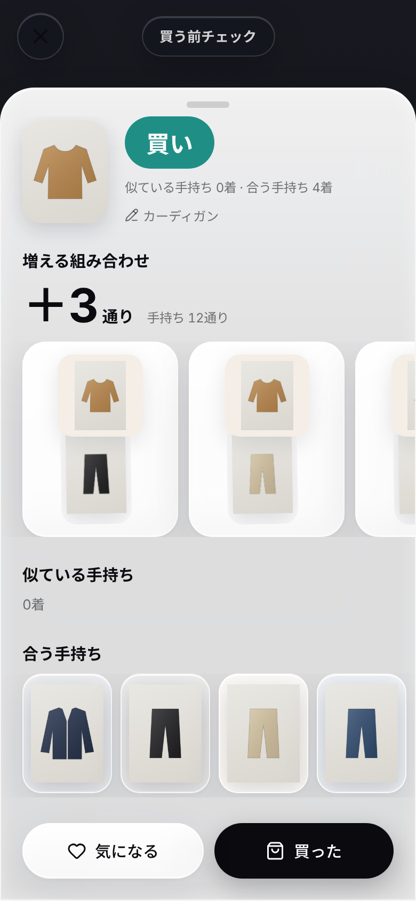
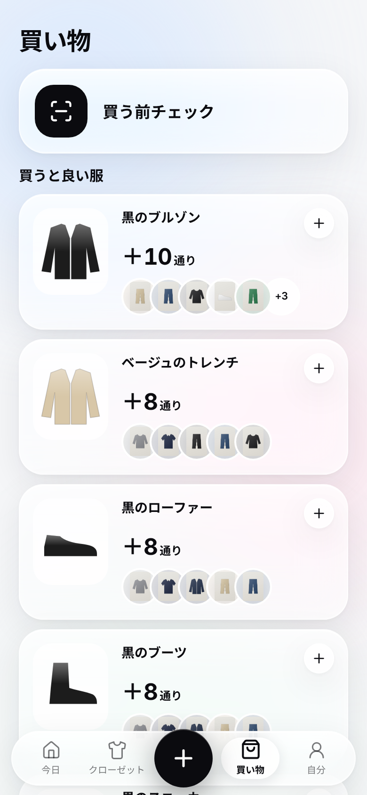

# Mottenai

手持ちの服を記録して、買う前に「似た服を持っていないか」「手持ちと何通り組めるか」を確かめるクローゼット管理Webアプリ（モバイル向け・PWA）。

## できること（MVP）

| 機能 | 内容 |
|---|---|
| 登録 | ＋ボタンでカメラが開き、連続撮影できる。写真から選ぶ（最大50枚）、ECの商品URLから取り込む、共有メニューから送る、にも対応。背景の切り抜きとAIによるタグ付けは裏で行う |
| 確認待ち | AIが付けたタグをカードで確認する。右へスワイプで確定、札を押すとその場で直る。確認しなくても提案には使われる |
| 買う前チェック | ＋ボタンの長押し、または買い物タブから。撮るだけで `買い / 保留 / 見送り`、増える組み合わせの数、似ている手持ち（%）、合う手持ちを表示する。「買った」を押すとその写真のまま登録される |
| 買うと良い服 | 定番アイテムの見本集から、手持ちに足したときに組み合わせが一番増えるものを順に出す。出番のない服が活きるかどうかも出す。買い物リストに保存できる |
| 今日 | 天気に合わせたコーデ3案。1案は出番のない服を使う。服を押すと入れ替わる。「これを着る」で着た記録が付く |
| クローゼット | 一覧、カテゴリ・出番なしでの絞り込み、新しい順・色順・着た回数の並べ替え、詳細（組める数・着た回数・1回あたりの値段・似ている手持ち・合う手持ち） |
| 自分 | 服の傾向、天気の地域、データの書き出し、ログアウト、アカウント削除 |

## 技術

React 19 / Vite / TanStack Query / Motion / Tailwind CSS v4 / Hono / Cloudflare Workers・D1・R2・Images・Workers AI / Arctic（Google OAuth）。
選定理由は [docs/04-tech-stack.md](docs/04-tech-stack.md)。

## ドキュメント

1. [既存アプリ調査](docs/01-research.md)
2. [ペイン分析](docs/02-pain-analysis.md)
3. [UX設計](docs/03-ux-design.md)
4. [技術選定と理由](docs/04-tech-stack.md)

## ローカルで動かす

```bash
npm install
cp .dev.vars.example .dev.vars
npm run db:migrate:local
npm run dev
```

`.dev.vars` の `DEV_AUTH=1` で「開発用ログイン」ボタンが出る。`MOCK_AI=1` のときは Workers AI を呼ばずに仮のタグを付ける（Cloudflare の認証情報がない環境用）。

```bash
npm test          # 組み合わせ・類似度・判定ロジックのテスト
npm run typecheck
npm run lint
```

## 公開する

1. Cloudflare でリソースを作る

```bash
npx wrangler d1 create mottenai
```

```bash
npx wrangler r2 bucket create mottenai-images
```

出力された `database_id` を `wrangler.jsonc` に書く。Cloudflare Images（背景切り抜き用）をアカウントで有効にする。

2. Google Cloud Console で OAuth クライアント（ウェブアプリ）を作り、承認済みのリダイレクト URI に `https://<公開URL>/auth/google/callback` を追加する。

3. シークレットを登録する

```bash
npx wrangler secret put GOOGLE_CLIENT_ID
```

```bash
npx wrangler secret put GOOGLE_CLIENT_SECRET
```

4. デプロイ

```bash
npm run db:migrate:remote
```

```bash
npm run deploy
```

GitHub Actions を使う場合は、リポジトリのシークレットに `CLOUDFLARE_API_TOKEN` と `CLOUDFLARE_ACCOUNT_ID` を登録すると、main への push で自動デプロイされる。

## 画面

| 今日 | クローゼット | 買う前チェック（見送り） | 買う前チェック（買い） | 買うと良い服 |
|---|---|---|---|---|
|  |  |  |  |  |

ローカル環境で撮影したもの。背景の切り抜き（Cloudflare Images）はローカルでは動かないので、写真の背景が残っている。
