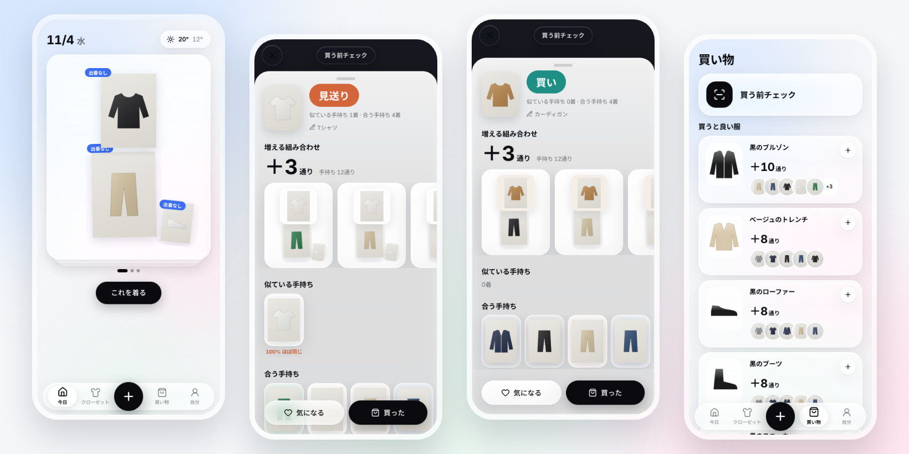

<p align="center">
  
</p>

# Mottenai

> Check your closet before you buy.

**English** · [日本語 (README.ja.md)](README.ja.md)

[](https://github.com/ttk1010/mottenai/actions/workflows/deploy.yml)
[](LICENSE)
[](https://workers.cloudflare.com/)
[](https://www.typescriptlang.org/)

<p align="center">
  
</p>

<p align="center"><a href="docs/assets/demo.mp4">▶ Watch the 30-second demo</a></p>

## What is this?

Mottenai is a mobile-first closet app for one specific problem: **you go shopping, can't tell what to buy, and come home with something you already own or can't wear with anything.**

Snap the item in the store. Mottenai compares it with everything in your closet and answers in a few seconds:

- **Buy / Hold / Skip**, decided by rules, not vibes
- **+N outfits**: how many new combinations it unlocks with clothes you own
- **Similar items you own**, with a similarity percentage (85%+ means "almost the same")
- **Items it pairs with**, flagging the ones that are sitting unworn

It also ranks **what to buy next** by how many outfits each piece would add, and suggests **today's outfit** for the weather, always including one piece you haven't worn.

The name puns on *mottainai* (wasteful) and *motte-nai* (don't own it): buy what you don't have, not what you do.

> 📖 The README is in English and Japanese. The design docs (`docs/`, ADRs) and the app UI are in **Japanese**.

## Example

A white T-shirt when you already own one:

| Pre-purchase check | Result |
|---|---|
| Verdict | **見送り** (Skip) |
| Why | Similar items owned: 1 · Pairs with: 4 |
| +N outfits | +3 (your closet already makes 12) |
| Similar items | White T-shirt — **100% almost the same** |

A camel cardigan in the same closet gets **買い** (Buy): nothing similar, +3 outfits, pairs with 4 pieces. Tap **買った** (Bought) and the photo you just took is added to your closet, no second shot needed.

More screens: [docs/screenshots/](docs/screenshots/).

## Requirements

- **A Cloudflare account (free).** Workers, D1, R2, Images and Workers AI on the free plan. R2 asks for a payment method on activation, but you're only billed beyond 10 GB/month.
- **A Google Cloud project (free)** for Google sign-in, the only login method.
- **A GitHub repository** for automatic deploys via GitHub Actions.
- **Node.js 22+** for local development.

### Cost

Free for personal and small-group use. When a free quota runs out, most features **degrade instead of billing**:

| Service | Free tier | When exceeded |
|---|---|---|
| Workers | 100k requests/day | Requests fail |
| D1 | 5 GB, 5M rows read/day | Queries fail |
| R2 | 10 GB/month | **Billed** (photos are under 1 MB per item, so roughly 10,000 items fit) |
| Workers AI | 10k Neurons/day | Auto-tagging stops; you pick tags by hand |
| Images | 5,000 transformations/month | Saved without background removal |

Prices change; see [Cloudflare's pricing](https://www.cloudflare.com/plans/developer-platform/).

## Quickstart (local)

```bash
# 1. Install
npm install

# 2. Local settings: dev login + mock AI (no Cloudflare credentials needed)
cp .dev.vars.example .dev.vars
npm run db:migrate:local

# 3. Run
npm run dev        # → http://localhost:5173, tap 開発用ログイン (dev login)
```

`MOCK_AI=1` generates placeholder tags because Workers AI only runs remotely. Background removal is skipped locally.

```bash
npm test           # judgment engine tests
npm run typecheck
npm run lint
```

## Deploy

**Follow [docs/SETUP_GUIDE.md](docs/SETUP_GUIDE.md) (Japanese).** It's a click-by-click guide written for first-timers:

1. **Cloudflare**: an API token, a D1 database, an R2 bucket, and the `workers.dev` subdomain
2. **GitHub**: four Actions secrets, plus your `database_id` in `wrangler.jsonc`
3. **Google**: an OAuth consent screen, test users, and a web client

After that, every push to `main` runs lint, typecheck, tests and build, applies D1 migrations, deploys the Worker and syncs the Google secrets. Your app goes live at `https://mottenai.<subdomain>.workers.dev`.

Stuck? See [docs/TROUBLESHOOTING.md](docs/TROUBLESHOOTING.md).

## Features

- **3-second capture**: the camera opens on the first tap and you shoot item after item; uploads continue in the background. Also imports from photos (up to 50), product-page URLs, and the share sheet.
- **AI does the typing**: background removal (Cloudflare Images) and tags (category, color, pattern, formality, warmth, season, fit) via Workers AI. Unreviewed items still count toward suggestions.
- **Swipe review**: confirm AI tags by swiping right; tap a tag to fix it in place.
- **Pre-purchase check**: long-press **＋** (or use the home-screen shortcut) for an instant Buy / Hold / Skip.
- **What to buy next**: ranked by the number of outfits each piece would add, avoiding things you already own. Save picks to a shopping list.
- **Today**: three weather-aware outfits; one always uses an unworn piece. Tap a piece to swap it; tap **これを着る** (Wear this) to log it.
- **First value at 10 items**: onboarding shows your first outfit count as soon as 10 items are in.
- **Liquid Glass UI** on a white base, motion throughout, and skeleton loading on every screen. Respects `prefers-reduced-motion`.
- **Your data**: JSON export and full account deletion (photos included).

## How it works

```
Phone (PWA) ── React SPA ── judgment engine runs in the browser
     │
     ▼
Cloudflare Worker (Hono)
  ├─ Google OAuth (Arctic) + cookie sessions
  ├─ D1 ──────── users, items, wear logs, wants
  ├─ R2 ──────── photos and cutouts (private, served per user)
  ├─ Images ──── background removal
  └─ Workers AI ─ photo → tags   (tags only; never the verdict)
```

**Verdicts are rules, AI only tags.** Similarity, pairing, +N outfits and the verdict are computed by a tested, deterministic engine ([`src/shared/engine.ts`](src/shared/engine.ts)), so the numbers on screen are explainable and stable. Details: [docs/ARCHITECTURE.md](docs/ARCHITECTURE.md) and [ADR 0001](docs/adr/0001-rule-based-judgment.md).

## Philosophy

Mottenai is **not** a fashion feed and **not** a shopping funnel. It's a second opinion that remembers your closet when you can't.

- **Answer at the moment of decision**: the store, not the morning
- **Numbers over adjectives**: `87% similar`, `+12 outfits`, no taglines
- **Effortless capture**: a photo is the only required input
- **No conflict of interest**: no affiliate links, so it can say "skip"
- **Free to run**: Cloudflare free tier, degrading gracefully at the limits

The research and pain analysis behind these choices: [docs/01-research.md](docs/01-research.md), [docs/02-pain-analysis.md](docs/02-pain-analysis.md).

## Documentation

Design docs are in Japanese.

| Document | Purpose |
|---|---|
| [docs/SETUP_GUIDE.md](docs/SETUP_GUIDE.md) | Step-by-step setup: Cloudflare, Google, GitHub |
| [docs/TROUBLESHOOTING.md](docs/TROUBLESHOOTING.md) | Setup and runtime troubleshooting |
| [docs/01-research.md](docs/01-research.md) | Survey of existing closet apps |
| [docs/02-pain-analysis.md](docs/02-pain-analysis.md) | Pain analysis and jobs-to-be-done |
| [docs/03-ux-design.md](docs/03-ux-design.md) | UX design: flows, screens, motion, skeletons |
| [docs/04-tech-stack.md](docs/04-tech-stack.md) | Technology choices and the reasons for each |
| [docs/ARCHITECTURE.md](docs/ARCHITECTURE.md) | System architecture and data flow |
| [docs/adr/](docs/adr/) | Architecture Decision Records |
| [docs/ROADMAP.md](docs/ROADMAP.md) | Roadmap |

## Roadmap & status

🚧 **MVP complete and deployed** (Phase 1). Next up (Phase 2): measuring AI tag accuracy in production, cutting garments out of model photos, and replacing the deprecated OAuth library. See [docs/ROADMAP.md](docs/ROADMAP.md).

## Contributing

Small, issue-driven changes are welcome. See [CONTRIBUTING.md](CONTRIBUTING.md).

## License

[MIT](LICENSE) © 2026 ttk1010

### Credits

The narration in the [demo video](docs/assets/demo.mp4) was synthesized with [Open JTalk](https://open-jtalk.sourceforge.net/) (BSD-3-Clause) using the HTS voice `nitech_jp_atr503_m001`, © Nagoya Institute of Technology, licensed under [CC BY 3.0](https://creativecommons.org/licenses/by/3.0/).
